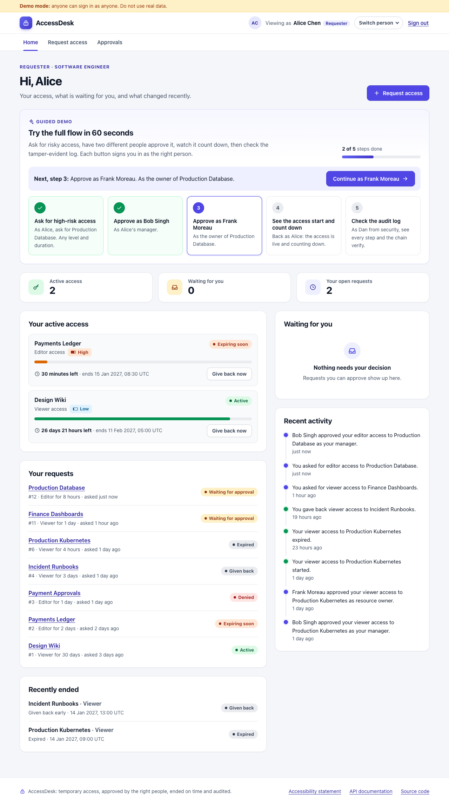
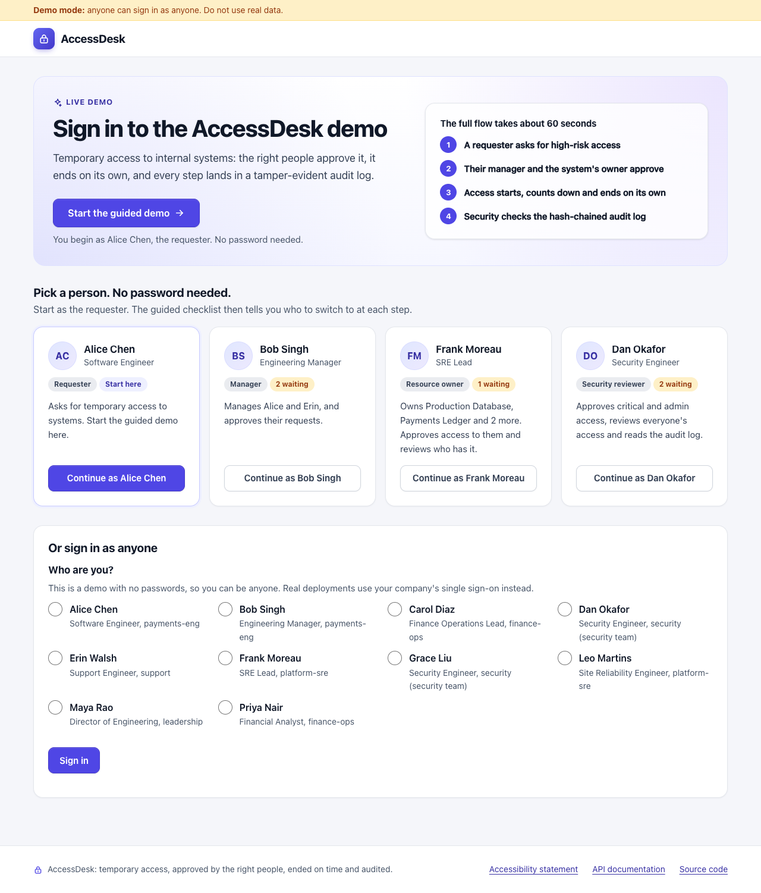
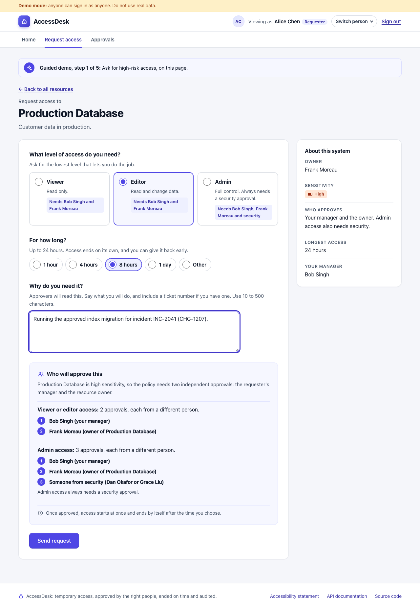
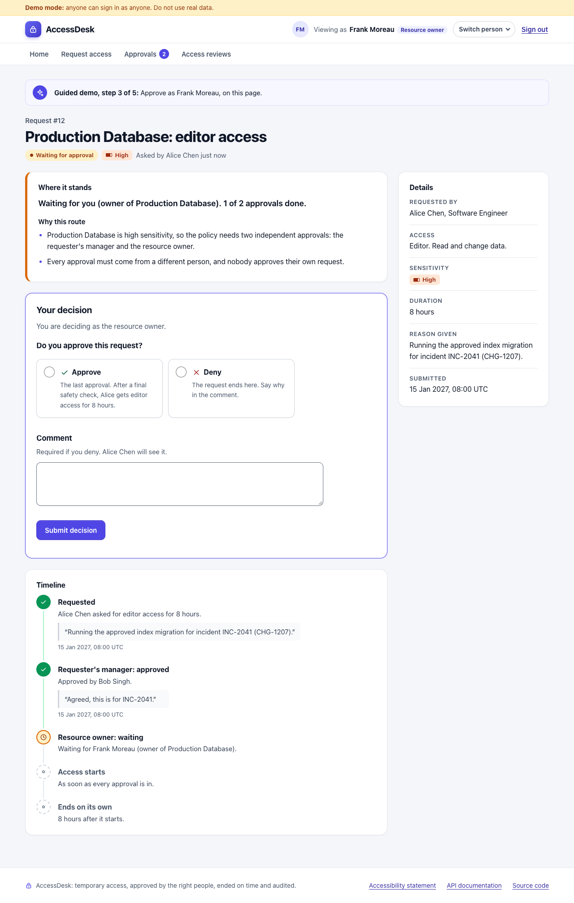
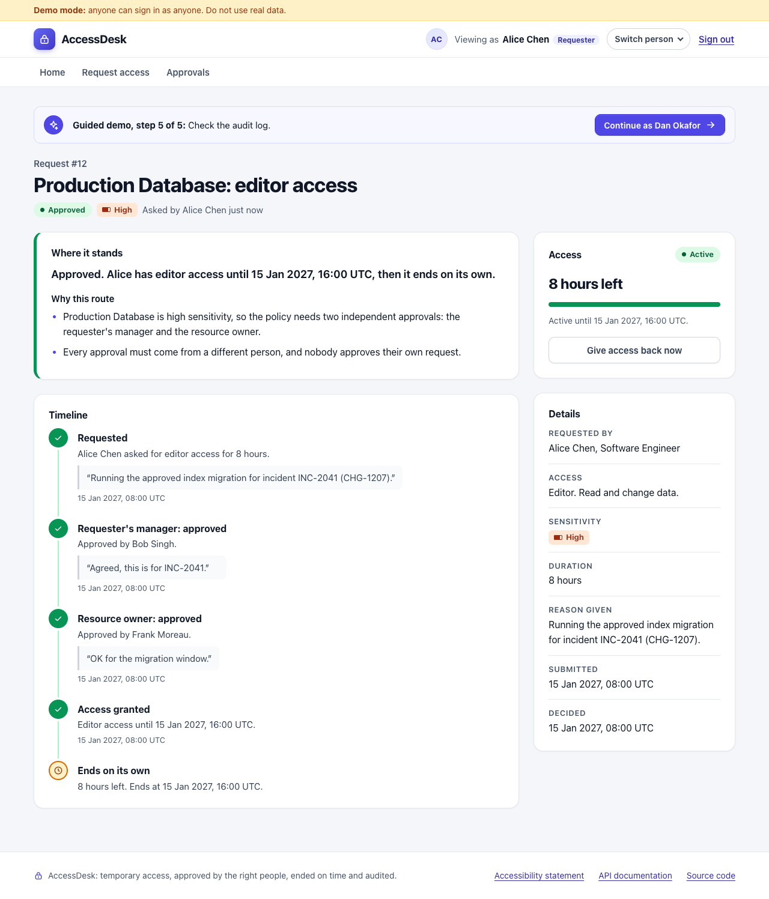
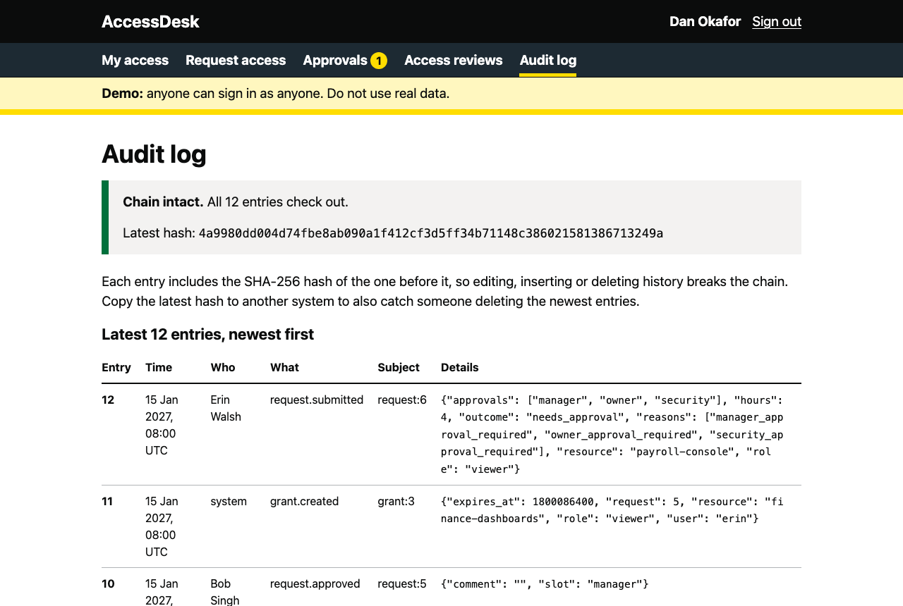
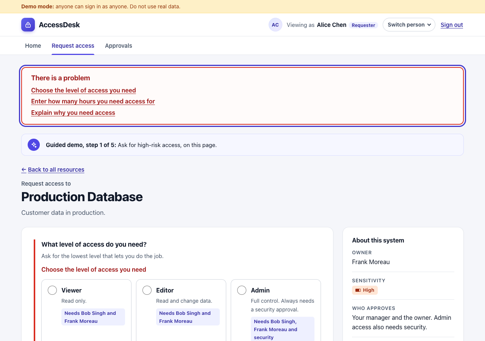
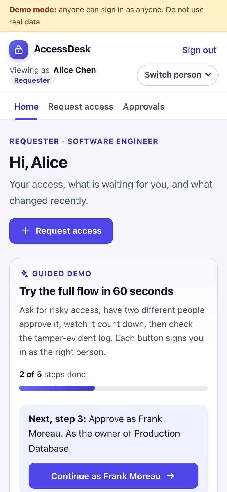
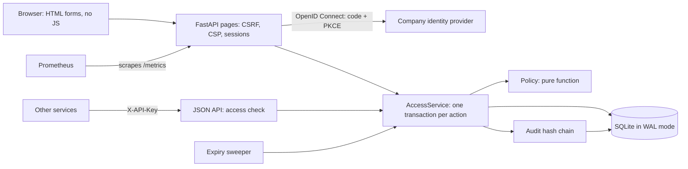

# AccessDesk

**Temporary access to internal systems: approved by the right people, ended on time, audited for good.**
People ask for just-in-time access, a pure and property-tested policy picks who must approve, four-eyes and
separation-of-duties rules hold even when approvers race, access ends on its own, and every change lands in
a tamper-evident audit log. It uses no JavaScript, targets WCAG 2.2 AA and runs under a strict CSP.

[](https://render.com/deploy?repo=https://github.com/gargshishirr/accessdesk)

[](https://github.com/gargshishirr/accessdesk/actions/workflows/ci.yml)




**[Read the guide](GUIDE.md)** for how to use it, set up company sign-in, load your directory and run it.

## Try it

Start a demo on your own machine (see [Quick start](#quick-start)), or deploy a free one with the button
above. The demo has no passwords: **Start the guided demo** on the sign-in page makes you Alice, the
requester, and four persona cards let you become any main character with one click.

| Person | Role in the demo | What they can do |
|---|---|---|
| **Alice Chen** | Requester | Asks for temporary access. Start here. |
| **Bob Singh** | Manager | Approves requests from Alice and Erin, his team. |
| **Frank Moreau** | Resource owner | Owns the production database and more; approves access to them and reviews who has it. |
| **Dan Okafor** | Security reviewer | Approves critical and admin access, reviews everyone's access and reads the audit log. |

Everyone else in the demo company is one radio button away, and **Switch person** in the header changes who
you are on any page.

**The full flow in 60 seconds.** Alice's home page has a checklist. Each step ticks off from what really
happened, and its **Continue as** button signs you in as the right person and opens the right page:

1. As Alice, ask for the **Production Database**. Before you send it, the form says who the policy will
   ask, by name: Bob and Frank (and security as well if you pick admin).
2. As Bob, her manager, approve it.
3. As Frank, the owner, give the second, independent approval.
4. Back as Alice, open the request: the access is live, counting down, and will end on its own.
5. As Dan, open the audit log: every step is there and the hash chain verifies.

The demo data is a few days of realistic history, so every approver has work waiting, one of Alice's grants
is about to expire, and the audit log, reviews and dashboards are full from the first click.

| | |
|---|---|
|  |  |
| One click to become any of the four main characters. | Who will approve, by name, for each access level, from the real policy. |
|  |  |
| The owner's view: where it stands, why, and the decision. | Every step, then the countdown to automatic expiry. |
|  |  |
| The chain is re-verified every time the log opens. | Every problem is listed, linked to its field and announced. |



## Why

Standing access (people keeping powerful permissions long after they needed them) is a classic security and
audit problem. Just-in-time, least-privilege access fixes it, but only if the tool is quick and usable for
everyone, including people who use a keyboard, a screen reader, zoom or high contrast. AccessDesk is a small,
complete version of that internal tool.

## What it does

- **Company single sign-on.** OpenID Connect with PKCE, state and nonce, so it works with Google Workspace,
  Microsoft Entra ID, Okta, Auth0, Keycloak and others. Only people in the directory can sign in, and the
  demo person picker does not exist once single sign-on is on.
- **Policy-routed approvals.** A pure, property-tested policy decides who must approve, based on the
  resource's sensitivity and the role requested. Low-risk read access for pre-approved teams is instant,
  high-risk access needs the manager and the resource owner, and critical access also needs security.
  Admin access always adds security.
- **Four-eyes by construction.** Each approval slot is filled by a different person, and nobody approves
  their own request. If the manager also owns the resource, or the requester does, the policy brings in
  security so there are still two independent approvers.
- **Separation of duties.** Rules such as "nobody may both edit payments and release them" are checked
  when a request is submitted **and again at the final approval**. Two requests approved in parallel can
  never add up to a forbidden pair.
- **Access that ends on its own.** Grants expire automatically. The check API refuses access from the
  second a grant expires, even before the background sweeper runs. People can give access back early,
  and owners or security can remove it with a reason.
- **Tamper-evident audit log.** Every change appends a SHA-256 hash-chained entry in the same transaction,
  so the log and the data never disagree. Verification points to the first edited, inserted or deleted entry.
- **Safe under concurrency.** Writes take SQLite's write lock up front (`BEGIN IMMEDIATE`), and every
  request carries a version number. Racing approvers produce exactly one grant, and a stale page gets a
  clear "this request changed" message.
- **Accessible by default.** It targets WCAG 2.2 AA and uses no JavaScript. Forms use GOV.UK-style error
  summaries, focus is always visible, and pages work at 320 px wide and in Windows high contrast mode.
  See [Accessibility](#accessibility).
- **Clear at a glance.** A home dashboard shows your access with time-left bars and "expiring soon"
  warnings, what is waiting for your decision and recent activity in plain words. Request pages show a
  timeline and explain, in plain English, why the policy chose that route.
- **A guided demo.** In demo mode only: one-click personas, a person switcher and a checklist that walks
  through the whole flow in about a minute. None of it exists once single sign-on is on.
- **A directory you control.** People, managers, resources, owners and separation-of-duties rules load from
  one JSON file. Removing a person ends their sessions, access and pending requests in the same transaction.
- **Ready to operate.** Other services call `GET /api/v1/check` with an API key (several keys can be live,
  for rotation). There are also `/api/v1/audit/verify`, `/healthz` and Prometheus `/metrics`, server-side
  sessions, rate limits, a strict CSP, security headers, CSRF tokens and open-redirect protection.

## Quick start

```bash
python -m venv .venv
. .venv/bin/activate            # Windows: .venv\Scripts\activate
pip install -e ".[dev]"
accessdesk serve                # http://127.0.0.1:8000
```

This starts in **demo mode**: a yellow banner says anyone can sign in as anyone, and the first run adds demo
people, resources and a few days of requests. Choose **Continue as Alice Chen** and follow the checklist on
the home page (see [Try it](#try-it)). The [guide](GUIDE.md#set-up-single-sign-on) shows how to switch on
company sign-in.

Other services ask for decisions over HTTP (interactive docs at `/api/docs` in demo mode):

```bash
curl -H "X-API-Key: <key printed at startup>" \
  "http://127.0.0.1:8000/api/v1/check?user=alice&resource=design-wiki&role=viewer"
# {"allowed":true,"reason":"active_grant","expires_at":<unix time>,"grant_id":1}
```

| Setting | Default | Meaning |
|---|---|---|
| `ACCESSDESK_DB` | `accessdesk.db` | SQLite database file |
| `ACCESSDESK_SECRET_KEY` | random per run | Signs session cookies. Required (32+ characters) with single sign-on |
| `ACCESSDESK_API_KEYS` | demo: random per run, printed | Comma-separated keys for `/api/v1/*` and `/metrics`. `ACCESSDESK_API_KEY` (one key) also works. With single sign-on and no key, the API is off |
| `ACCESSDESK_PUBLIC_URL` | `RENDER_EXTERNAL_URL` on Render | The site's address. Required with single sign-on |
| `ACCESSDESK_OIDC_ISSUER`, `_CLIENT_ID`, `_CLIENT_SECRET` | unset (demo mode) | Turn on single sign-on |
| `ACCESSDESK_OIDC_ALLOWED_DOMAINS` | any | Email domains that may sign in. Required for Google |
| `ACCESSDESK_DIRECTORY_FILE` | unset | Directory JSON that `accessdesk serve` loads at start-up |
| `ACCESSDESK_SESSION_HOURS` | `24` | Sign-in lifetime |
| `ACCESSDESK_SIGNIN_RATE_LIMIT` | `30` | Sign-ins started per client address and minute (`0` = off) |
| `ACCESSDESK_CLIENT_IP_HEADER` | unset | Header a trusted proxy fills with the visitor's address (last value used), such as `CF-Connecting-IP` on Render |
| `ACCESSDESK_API_RATE_LIMIT` | `6000` | API calls per key and minute (`0` = off) |
| `ACCESSDESK_SWEEP_SECONDS` | `30` | How often expired grants are ended (`0` turns the sweeper off) |
| `ACCESSDESK_SECURE_COOKIES` | `true` if the public URL is https | Secure `__Host-` cookie and HSTS. Must stay on with https |

Settings that cannot work stop the app with a message naming the one to fix; it never falls back to demo
mode. Other commands:

```bash
accessdesk directory export directory.json          # write people, resources and rules as JSON
accessdesk directory import directory.json --dry-run # show what would change; drop --dry-run to apply
accessdesk backup backups/accessdesk.db             # online, consistent copy (owner-only permissions)
accessdesk verify-audit                             # check the hash chain; exit code 1 if broken
accessdesk seed                                     # demo data for an empty database (demo mode only)
```

To run several workers, first set `ACCESSDESK_SECRET_KEY` and `ACCESSDESK_API_KEYS` so every worker shares
them, then run `uvicorn accessdesk.web.app:create_app --factory --workers 4` (rate limits are counted per
worker). A [`Dockerfile`](Dockerfile) builds a non-root image that keeps its database on the `/data` volume.

### Deploy to Render

[](https://render.com/deploy?repo=https://github.com/gargshishirr/accessdesk)

[`render.yaml`](render.yaml) runs AccessDesk as a public demo on the free plan, with secure cookies and HSTS
on and a generated session secret and API key (shown in the service's **Environment** tab). Free services
have no persistent disk, so the database starts again with fresh demo data (and a fresh guided demo)
whenever the service restarts or wakes up; they also sleep after 15 idle minutes and take about a minute to
wake. Everyone using one demo site shares its data, so visitors may see each other's requests. For real use, add a
[persistent disk](https://render.com/docs/disks) and single sign-on as described in
[the guide](GUIDE.md#run-it-on-render).

## How it works



| Sensitivity | Who approves | Notes |
|---|---|---|
| Low | Manager | Viewer access is instant for teams the owner pre-approved |
| Medium | Manager | |
| High | Manager and owner | |
| Critical | Manager, owner and security | |
| Admin role, any sensitivity | Adds security | |

If the requester has no manager on file, security approves instead. If the requester owns the resource,
or their manager does, security takes the owner's place.

## Design decisions

- **The policy is a pure function.** `policy.evaluate(draft, context)` does no I/O and reads no clock, so it
  has table tests plus Hypothesis property tests. The properties are: decisions are deterministic,
  auto-approval only happens for low-risk read access, escalation never reduces the number of approvers,
  approvers are never the requester or doubled up, and invalid requests are always denied.
- **Fail closed.** Expired grants never pass a check. The final approval re-checks access already held and
  separation of duties. Unknown users, stale versions and missing CSRF tokens are refused.
- **One transaction per action, audit entry included.** If anything fails, nothing is half-saved.
- **The hot path skips the thread pool.** Profiling showed FastAPI made two thread hand-offs per check (one
  for the handler, one for response validation). Each cost about 40 times the 10 µs indexed lookup itself.
  The check endpoint is now async and does its read directly on the event loop, where WAL readers never
  wait for writers. Slow work, such as re-hashing the audit chain, still uses the thread pool. On one
  client, p50 latency fell from 1.78 ms to 0.97 ms. On 4 workers, throughput rose from 1,592 to 3,389 checks/s.
- **No JavaScript.** Every action is a form post followed by a redirect. That is the most robust baseline
  for assistive technology, and it allows a strict CSP (`default-src 'none'`). The person switcher is a
  native `<details>` element, and CSS `:has()` highlights radio cards and reveals the "Other" hours box.
- **Polish without loosening the CSP.** All styling lives in one static stylesheet: time-left bars use
  5%-step width classes instead of inline styles, icons are inline SVG drawn with presentation attributes,
  and text uses the system font stack, so the policy needs no `unsafe-inline`, `font-src` or third party.
- **The guided demo reads real state.** The approval summary on the request form calls the same
  `policy.evaluate` that submitting does (a test checks they agree, role by role), and the checklist ticks
  off from the requester's newest high-risk request, so it can never claim a step that did not happen. The
  last two steps tick only once you open the page they point to (the live access as the requester, the
  audit log as security); the session remembers just those request numbers, never anything that signs you in.
- **Sign-in is checked step by step, and sessions live on the server.** A small typed OpenID Connect client
  (`oidc.py`) runs the code flow with PKCE, state and nonce, and checks ID tokens with
  [joserfc](https://jose.authlib.org): asymmetric signatures from the provider's published keys only, then
  issuer, audience, expiry, nonce and a verified email. Each sign-in creates a new random session id; the
  database keeps only its hash, so signing out or leaving the directory ends the session everywhere.
- **SQLite on purpose.** It is one file in WAL mode with no setup. Only the service layer and the directory
  import touch SQL, so moving to PostgreSQL changes `db.py` and the queries, not the policy or the UI.

## Measured results

From `python scripts/bench_check.py`. The data is 5,000 people, 500 resources and 20,000 grants, 10% of
them expired but not yet swept. The server ran in its own process, and every HTTP answer was cross-checked
against the in-process answer. The machine was a laptop with an AMD Ryzen CPU (16 logical CPUs), Windows 11,
Python 3.14 and uvicorn with httptools. Raw output is in [`docs/benchmark.json`](docs/benchmark.json).

| Path | Checks | p50 | p95 | p99 | Throughput |
|---|---:|---:|---:|---:|---:|
| In-process `AccessService.check` | 20,000 | 0.010 ms | 0.020 ms | 0.035 ms | 85,823/s |
| HTTP, 1 worker, 1 client | 5,000 | 0.97 ms | 2.51 ms | 3.29 ms | 826/s |
| HTTP, 1 worker, 8 clients | 20,000 | 6.48 ms | 14.02 ms | 16.41 ms | 1,052/s |
| HTTP, 4 workers, 8 clients | 20,000 | 2.19 ms | 3.81 ms | 4.85 ms | 3,389/s |

Expect different numbers on other machines.

## Testing

| Suite | What it covers | Tests |
|---|---|---:|
| `test_policy.py` | Routing table, escalations, denials, separation of duties, 5 Hypothesis properties | 26 |
| `test_audit.py` | Hash chain, and tampering found at the exact entry (edit, delete, relink) | 7 |
| `test_service.py` | Workflows, expiry, fail-closed re-checks, versions, racing approvers on real threads | 28 |
| `test_web.py` | Demo sign-in, CSRF, security headers, open redirects, error summaries, the main page flows | 23 |
| `test_demo.py` | Persona sign-in and switching, the approval summary matching the policy role by role, duration presets, the guided checklist following real state, dashboards, timelines, decision hints, plain-words audit log | 23 |
| `test_sso.py` | Single sign-on end to end against a fake identity provider: PKCE, state, nonce, 14 kinds of bad ID token, key rotation, verified email, allowed domains, sessions, client authentication, rate limits, logs, and no demo personas, switcher or checklist | 48 |
| `test_security.py` | Who may approve what, audit log access, people who left, API key rotation, rate limits, client addresses, log redaction | 20 |
| `test_directory.py` | Directory import and export: adds, audited updates, leavers, retired resources, steps re-routed when nobody else can approve them, every mistake reported | 19 |
| `test_config.py` | Settings, and every half-done single sign-on setup refused | 22 |
| `test_api.py` | API key, fail-closed checks, tamper reporting, metrics labels, background sweeper | 6 |
| `test_cli.py` | `seed`, `verify-audit`, `serve`, `directory` and `backup` commands | 7 |
| `a11y/test_accessibility.py` | axe-core on 32 pages and states (demo and single sign-on) at two widths, the guided demo clicked through with axe at every stop, keyboard-only flow, skip link, forced colours | 36 |

All 265 tests pass with 96% branch coverage (checked locally on Python 3.11; CI runs 3.11 to 3.14). No test
needs the internet.

```bash
pytest -m "not a11y"                            # fast suite, no browser needed
playwright install chromium && pytest -m a11y   # browser suite (or set A11Y_BROWSER_CHANNEL=msedge)
ruff check . && ruff format --check . && mypy   # lint, formatting, strict typing
```

## Accessibility

AccessDesk targets WCAG 2.2 level AA. Every page and state (32 of them, including error states, the open
person switcher and the single sign-on pages) is scanned with axe-core at 1280 px and 320 px wide, and so is
every stop of the guided demo. The scan covers WCAG 2.0, 2.1 and
2.2 A and AA rules plus best-practice rules, and CI fails on any violation. Automated tests also cover:

- requesting and approving access with the keyboard only, with a visible focus indicator at every stop;
- the skip link;
- reflow at 320 px wide;
- focus that stays visible in forced colours mode.

Automated checks find only some problems, and the app has not yet had a manual screen-reader audit. The
full statement, including this limitation, is at `/accessibility`.

## Project layout

```text
src/accessdesk/
  models.py      domain types
  policy.py      pure approval policy
  service.py     business operations, one transaction each
  audit.py       SHA-256 hash chain
  db.py          SQLite schema, migrations, connections and write transactions
  oidc.py        OpenID Connect client: discovery, PKCE, token exchange, ID token checks
  directory.py   directory file: checks, import (one audited transaction) and export
  config.py      settings and the rules that stop a half-done setup
  web/           FastAPI pages, sign-in, demo personas and guided checklist, JSON API, security,
                 rate limits, metrics, templates and CSS
tests/           unit, property, web, sign-in (fake identity provider), API, CLI and browser tests
scripts/         benchmark and screenshots
GUIDE.md         how to use, run and look after AccessDesk
Dockerfile       non-root container image
render.yaml      one-click public demo on Render
```

## Limitations and next steps

- The directory comes from a JSON file, not live from the identity provider (no SCIM yet).
- Rate limits are kept in memory, per worker process.
- Signing out of AccessDesk does not sign you out of the identity provider.
- There are no email or chat notifications yet.
- SQLite suits a single host. Many replicas would need PostgreSQL.
- Times are shown in UTC only.
- The guided demo follows the newest high-risk request from the demo's requester, and a public demo's data is
  shared, so two visitors doing the checklist at once will see each other's steps.

## License

[MIT](LICENSE)
