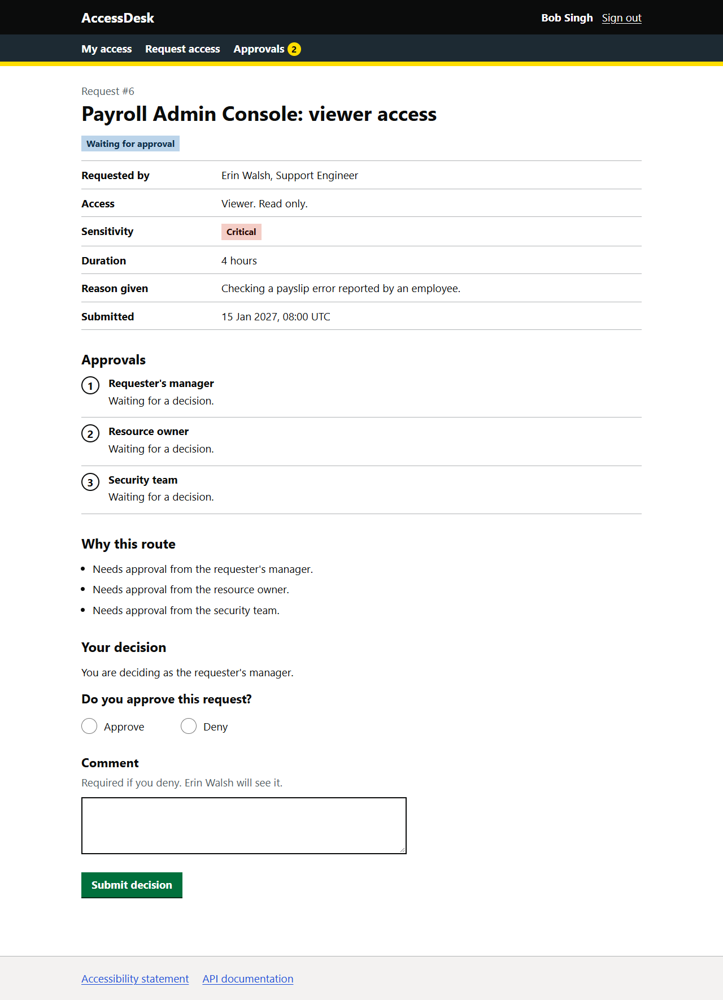
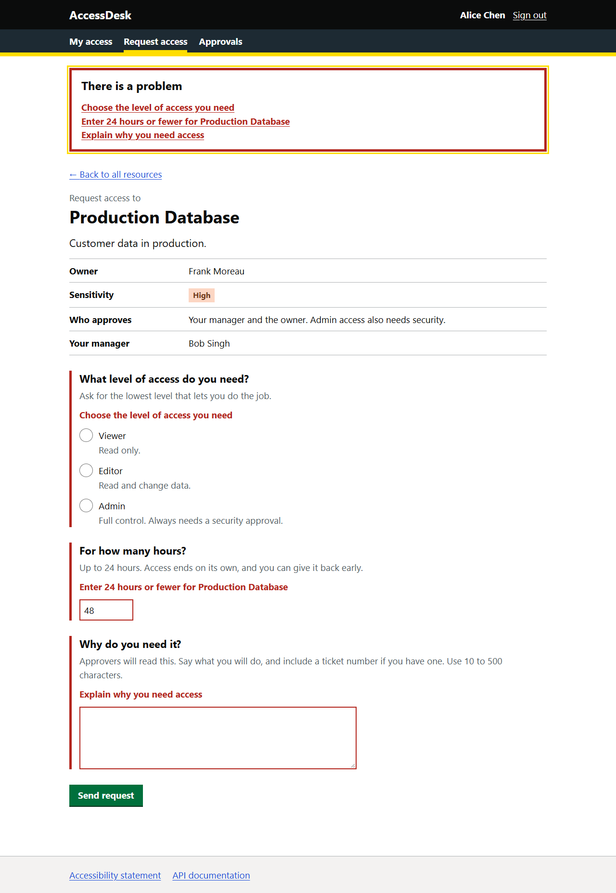
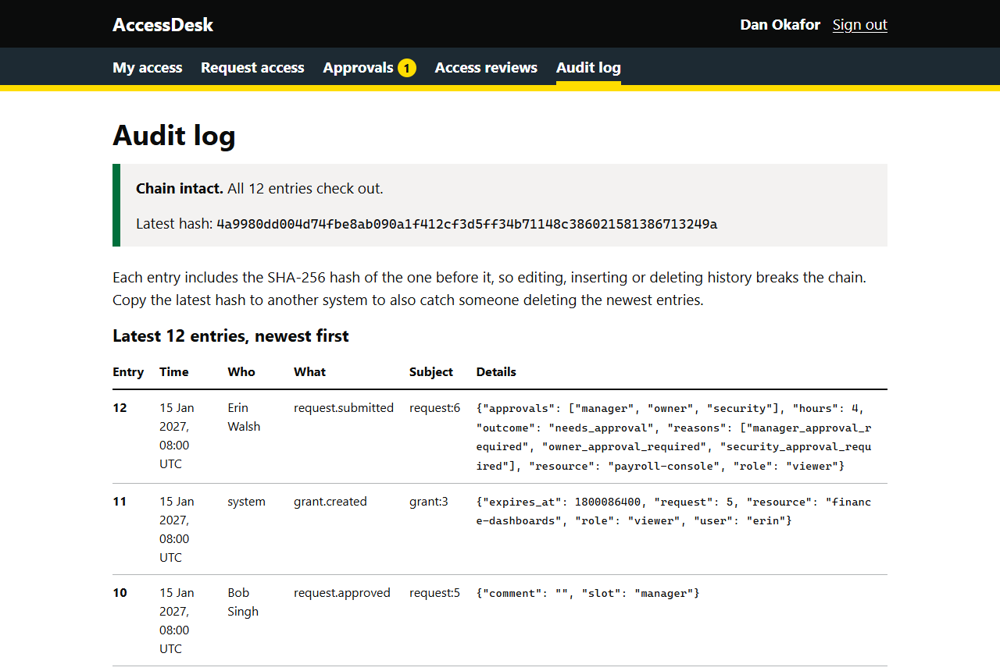
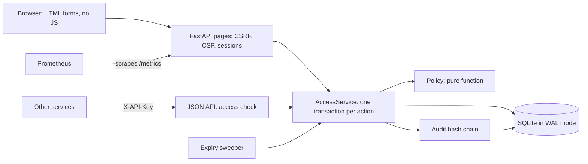

# AccessDesk

**Accessible, just-in-time access requests for employees.** People ask for temporary access to internal
systems, the right approvers say yes or no, access ends on its own, and every change lands in a
tamper-evident audit log.

[](https://github.com/gargshishirr/accessdesk/actions/workflows/ci.yml)




## Why

Standing access (people keeping powerful permissions long after they needed them) is a classic security and
audit problem. Just-in-time, least-privilege access fixes it, but only if the tool is quick and usable for
everyone, including people who use a keyboard, a screen reader, zoom or high contrast. AccessDesk is a small,
complete version of that internal tool.

## What it does

- **Policy-routed approvals.** A pure, property-tested policy decides who must approve, based on the
  resource's sensitivity and the role requested. Low-risk read access for pre-approved teams is instant,
  high-risk access needs the manager and the resource owner, and critical access also needs security.
  Admin access always adds security.
- **Four-eyes by construction.** Each approval slot is filled by a different person, and nobody approves
  their own request. If the manager also owns the resource, or the requester does, the policy brings in
  security so there are still two independent approvers.
- **Separation of duties.** Rules such as "nobody may both edit payments and release them" are checked
  when a request is submitted **and again at the final approval**. Two requests approved in parallel can
  never add up to a forbidden pair.
- **Access that ends on its own.** Grants expire automatically. The check API refuses access from the
  second a grant expires, even before the background sweeper runs. People can give access back early,
  and owners or security can remove it with a reason.
- **Tamper-evident audit log.** Every change appends a SHA-256 hash-chained entry in the same transaction,
  so the log and the data never disagree. Verification points to the first edited, inserted or deleted entry.
- **Safe under concurrency.** Writes take SQLite's write lock up front (`BEGIN IMMEDIATE`), and every
  request carries a version number. Racing approvers produce exactly one grant, and a stale page gets a
  clear "this request changed" message.
- **Accessible by default.** It targets WCAG 2.2 AA and uses no JavaScript. Forms use GOV.UK-style error
  summaries, focus is always visible, and pages work at 320 px wide and in Windows high contrast mode.
  See [Accessibility](#accessibility).
- **Ready to operate.** Other services call `GET /api/v1/check` with an API key. There are also
  `/api/v1/audit/verify`, `/healthz` and Prometheus `/metrics`, a strict CSP, security headers, CSRF
  tokens and open-redirect protection.

| | |
|---|---|
|  |  |
| Every problem is listed, linked to its field and announced. | The audit chain is verified on every view. |

## Quick start

```bash
python -m venv .venv
. .venv/bin/activate            # Windows: .venv\Scripts\activate
pip install -e ".[dev]"
accessdesk serve                # http://127.0.0.1:8000
```

The first run adds demo people, resources and requests. Then:

1. Sign in as **Alice Chen** and ask for access to the production database.
2. Sign in as **Bob Singh** (her manager), then as **Frank Moreau** (the owner), to approve it.
3. Sign in as **Dan Okafor** (security) to read the audit log.

Other services ask for decisions over HTTP (interactive docs at `/api/docs`):

```bash
curl -H "X-API-Key: <key printed at startup>" \
  "http://127.0.0.1:8000/api/v1/check?user=alice&resource=design-wiki&role=viewer"
# {"allowed":true,"reason":"active_grant","expires_at":<unix time>,"grant_id":1}
```

| Setting | Default | Meaning |
|---|---|---|
| `ACCESSDESK_DB` | `accessdesk.db` | SQLite database file |
| `ACCESSDESK_SECRET_KEY` | random per run | Signs session cookies |
| `ACCESSDESK_API_KEY` | random per run, printed | Key for `/api/v1/*` |
| `ACCESSDESK_SWEEP_SECONDS` | `30` | How often expired grants are ended (`0` turns the sweeper off) |
| `ACCESSDESK_SECURE_COOKIES` | `false` | Set to `true` behind HTTPS (also sends HSTS) |

Other commands: `accessdesk seed` adds the demo data to an empty database. `accessdesk verify-audit` checks
the hash chain and exits with code 1 if it is broken. To run several workers, first set
`ACCESSDESK_SECRET_KEY` and `ACCESSDESK_API_KEY` so every worker shares them, then run
`uvicorn accessdesk.web.app:create_app --factory --workers 4`.

## How it works



| Sensitivity | Who approves | Notes |
|---|---|---|
| Low | Manager | Viewer access is instant for teams the owner pre-approved |
| Medium | Manager | |
| High | Manager and owner | |
| Critical | Manager, owner and security | |
| Admin role, any sensitivity | Adds security | |

If the requester has no manager on file, security approves instead. If the requester owns the resource,
or their manager does, security takes the owner's place.

## Design decisions

- **The policy is a pure function.** `policy.evaluate(draft, context)` does no I/O and reads no clock, so it
  has table tests plus Hypothesis property tests. The properties are: decisions are deterministic,
  auto-approval only happens for low-risk read access, escalation never reduces the number of approvers,
  approvers are never the requester or doubled up, and invalid requests are always denied.
- **Fail closed.** Expired grants never pass a check. The final approval re-checks access already held and
  separation of duties. Unknown users, stale versions and missing CSRF tokens are refused.
- **One transaction per action, audit entry included.** If anything fails, nothing is half-saved.
- **The hot path skips the thread pool.** Profiling showed FastAPI made two thread hand-offs per check (one
  for the handler, one for response validation). Each cost about 40 times the 10 µs indexed lookup itself.
  The check endpoint is now async and does its read directly on the event loop, where WAL readers never
  wait for writers. Slow work, such as re-hashing the audit chain, still uses the thread pool. On one
  client, p50 latency fell from 1.78 ms to 0.97 ms. On 4 workers, throughput rose from 1,592 to 3,389 checks/s.
- **No JavaScript.** Every action is a form post followed by a redirect. That is the most robust baseline
  for assistive technology, and it allows a strict CSP (`default-src 'none'`).
- **SQLite on purpose.** It is one file in WAL mode with no setup. Only the service layer touches SQL, so
  moving to PostgreSQL changes `db.py` and the queries, not the policy or the UI.

## Measured results

From `python scripts/bench_check.py`. The data is 5,000 people, 500 resources and 20,000 grants, 10% of
them expired but not yet swept. The server ran in its own process, and every HTTP answer was cross-checked
against the in-process answer. The machine was a laptop with an AMD Ryzen CPU (16 logical CPUs), Windows 11,
Python 3.14 and uvicorn with httptools. Raw output is in [`docs/benchmark.json`](docs/benchmark.json).

| Path | Checks | p50 | p95 | p99 | Throughput |
|---|---:|---:|---:|---:|---:|
| In-process `AccessService.check` | 20,000 | 0.010 ms | 0.020 ms | 0.035 ms | 85,823/s |
| HTTP, 1 worker, 1 client | 5,000 | 0.97 ms | 2.51 ms | 3.29 ms | 826/s |
| HTTP, 1 worker, 8 clients | 20,000 | 6.48 ms | 14.02 ms | 16.41 ms | 1,052/s |
| HTTP, 4 workers, 8 clients | 20,000 | 2.19 ms | 3.81 ms | 4.85 ms | 3,389/s |

Expect different numbers on other machines.

## Testing

| Suite | What it covers | Tests |
|---|---|---:|
| `test_policy.py` | Routing table, escalations, denials, separation of duties, 5 Hypothesis properties | 26 |
| `test_audit.py` | Hash chain, and tampering found at the exact entry (edit, delete, relink) | 7 |
| `test_service.py` | Workflows, expiry, fail-closed re-checks, versions, racing approvers on real threads | 28 |
| `test_web.py` | Sign-in, CSRF, security headers, open redirects, error summaries, the main page flows | 23 |
| `test_api.py` | API key, fail-closed checks, tamper reporting, metrics labels, background sweeper | 6 |
| `test_cli.py` | `seed`, `verify-audit` and `serve` commands | 2 |
| `a11y/test_accessibility.py` | axe-core on 22 pages and states at two widths, keyboard-only flow, skip link, forced colours | 25 |

All 117 tests pass with 96% branch coverage, and also pass on Python 3.11.

```bash
pytest -m "not a11y"                            # fast suite, no browser needed
playwright install chromium && pytest -m a11y   # browser suite (or set A11Y_BROWSER_CHANNEL=msedge)
ruff check . && ruff format --check . && mypy   # lint, formatting, strict typing
```

## Accessibility

AccessDesk targets WCAG 2.2 level AA. Every page and state (22 of them, including error states) is scanned
with axe-core at 1280 px and 320 px wide. The scan covers WCAG 2.0, 2.1 and 2.2 A and AA rules plus
best-practice rules, and CI fails on any violation. Automated tests also cover:

- requesting and approving access with the keyboard only, with a visible focus indicator at every stop;
- the skip link;
- reflow at 320 px wide;
- focus that stays visible in forced colours mode.

Automated checks find only some problems, and the app has not yet had a manual screen-reader audit. The
full statement, including this limitation, is at `/accessibility`.

## Project layout

```text
src/accessdesk/
  models.py      domain types
  policy.py      pure approval policy
  service.py     business operations, one transaction each
  audit.py       SHA-256 hash chain
  db.py          SQLite schema, connections and write transactions
  web/           FastAPI pages, JSON API, security, metrics, templates and CSS
tests/           unit, property, web, API, CLI and browser tests
scripts/         benchmark and screenshots
```

## Limitations and next steps

- Sign-in is a demo person picker. A real deployment would sit behind OIDC single sign-on.
- There are no email or chat notifications yet.
- SQLite suits a single host. Many replicas would need PostgreSQL.
- Times are shown in UTC only.

## License

[MIT](LICENSE)
